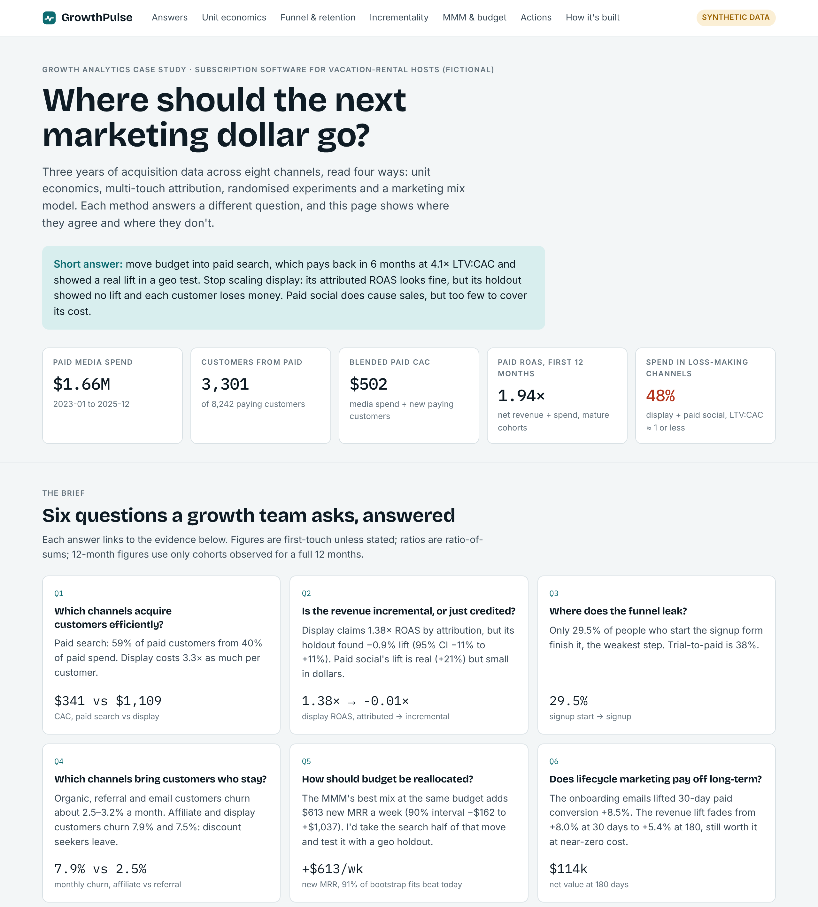
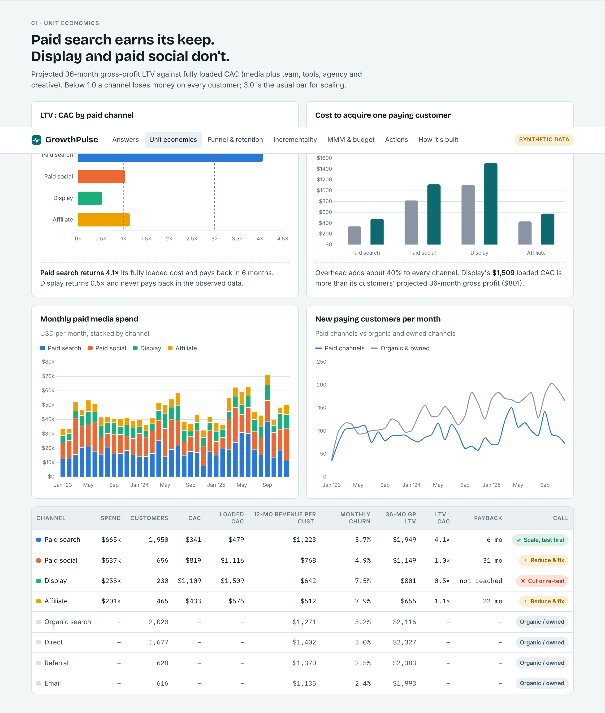
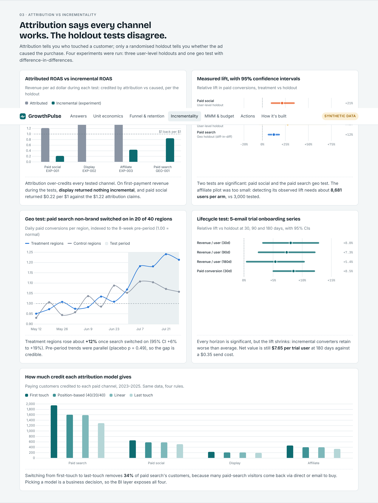
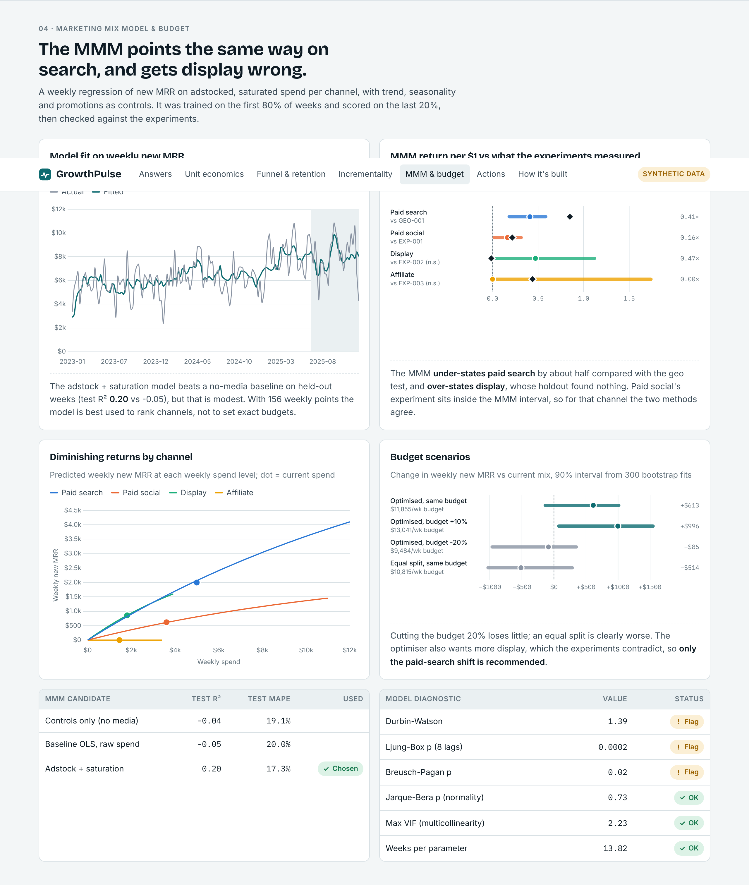
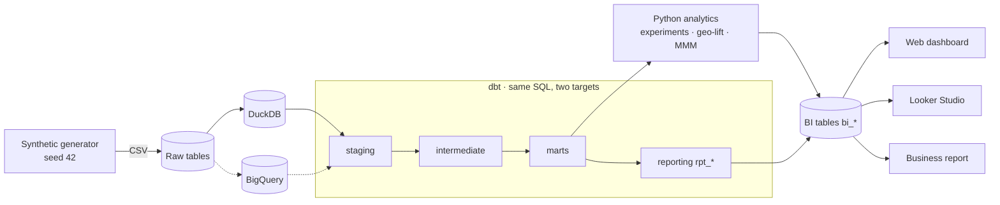

# GrowthPulse — where should the next marketing dollar go?

An end-to-end growth analytics project for a fictional subscription software company that sells to vacation-rental hosts. It takes three years of marketing, product and billing data through a tested dbt warehouse, measures every paid channel four ways (unit economics, attribution, randomised experiments, marketing mix model), and turns the result into budget recommendations.

**[Open the live dashboard →](https://shieldemma.github.io/growthpulse/)**  ·  [Looker Studio report](https://datastudio.google.com/reporting/2f3edcc5-b54e-4ac4-a770-fde083e9f55f)  ·  [Business report](reports/example/business_report.md)  ·  [Methodology](docs/methodology.md)  ·  [Role alignment](docs/job_alignment.md)




> **Synthetic data.** The company, its marketing and its experiments are simulated with a fixed seed so every method can be checked against a known truth. The numbers show the methods working; they are not real market results.

---

## The brief

I built this against the responsibilities in a Senior Growth Data Analyst posting from a vacation-rental software company. The job asks for someone who can analyse paid search, paid social and organic performance; run geo-tests and holdouts and state their uncertainty; combine attribution with experimental evidence; co-own marketing data products in dbt; automate recurring reporting; and explain it all to marketing stakeholders. Each of those is a section of this repo.

## What the data says

| # | Question | Answer | Evidence |
|---|---|---|---|
| 1 | Which channels acquire customers efficiently? | **Paid search.** 59% of paid customers from 40% of paid spend. CAC $341 vs $1,109 for display. Projected LTV:CAC 4.1× with a 6-month payback. | Unit economics |
| 2 | Is the revenue incremental, or just credited? | **Display is credited, not incremental.** Attributed ROAS 1.38; its holdout found −0.9% lift (95% CI −11% to +11%). Paid social's +21% lift is real but returns $0.22 per $1 on first payments. | 3 user holdouts |
| 3 | Does paid search hold up under a causal test? | **Yes.** Switching on non-brand search in 20 of 40 regions lifted conversions 12% (95% CI +6% to +19%, randomisation p < 0.001, placebo passed). | Geo test (diff-in-diff) |
| 4 | Where does the funnel leak? | **The signup form.** Only 29.5% of people who start signup finish it. Display visitors convert to paid at 0.24% vs 2.63% for search. | Funnel mart |
| 5 | Which channels bring customers who stay? | Referral, email and organic customers churn 2.4–3.2% a month; affiliate and display customers churn 7.9% and 7.5%. | Cohort retention |
| 6 | How should budget move? | The MMM's best same-budget mix adds **+$613/week new MRR** (90% interval −$162 to +$1,037). Take the paid-search part of that shift and test it; ignore the MMM's call to add display, which the experiments contradict. | MMM + calibration |
| 7 | Does lifecycle marketing pay off long-term? | The trial onboarding emails lifted 30-day paid conversion 8.5%. The revenue lift fades from 8.0% to 5.4% by day 180 but is still worth **$114k** net. | Lifecycle holdout |

**Recommendation:** scale non-brand paid search inside a new geo holdout, pause display and re-test it with enough power, rebuild paid social around incremental CAC, re-run the under-powered affiliate pilot at about 8.7k users per arm, and roll the onboarding emails out to all trials.

## What's in the project

| Area | What I built | Where |
|---|---|---|
| Data modelling | dbt project: sources → staging → intermediate → marts → reporting star schema. 44 models, 135 tests incl. reconciliation, funnel monotonicity and attribution-credit checks. Same SQL runs on DuckDB and BigQuery via portable macros. | [`dbt_project/`](dbt_project) · [dbt guide](docs/dbt_guide.md) |
| Metrics | CAC (media and fully loaded), ROAS on mature cohorts only, observed and projected LTV, retention, payback. Censoring-safe, unit-tested. | [`metrics.py`](src/growthpulse/metrics.py) · [definitions](docs/looker_studio/field_definitions.md) |
| Attribution | First, last, linear and position-based in SQL, checked against an independent pandas implementation. | [`int_attribution_credit.sql`](dbt_project/models/intermediate/int_attribution_credit.sql) |
| Experiments | User-level holdouts with SRM checks, CIs, power/MDE and CACE; a geo test with diff-in-diff, randomisation inference and a placebo; a lifecycle test read at 30/90/180 days. | [`experiment.py`](src/growthpulse/experiment.py) · [`geo_lift.py`](src/growthpulse/geo_lift.py) · [`lifecycle.py`](src/growthpulse/lifecycle.py) |
| Marketing mix model | Adstock, lag and saturation; out-of-time test; block bootstrap intervals; diagnostics; budget scenarios; calibration against the experiments. | [`mmm/`](src/growthpulse/mmm) |
| BI layer | 27 documented BI tables exported as CSV, a Looker Studio report, a Power BI spec with DAX, and the static web dashboard. | [`dashboard/`](dashboard) · [Looker guide](docs/looker_studio/README.md) |
| Automation | One-command pipeline, scheduled BigQuery refresh workflow, a weekly insight brief and a guard-railed LLM prompt that may only use computed numbers. | [`run_pipeline.py`](scripts/run_pipeline.py) · [`insights.py`](src/growthpulse/insights.py) |
| Governance | Data dictionary, analytics standards, tracking plan for server-side event streaming, data-freshness table. | [`docs/`](docs) |

## Screens

| Unit economics | Attribution vs incrementality | MMM & budget |
|---|---|---|
|  |  |  |

The dashboard follows the viewer's light or dark setting ([dark preview](docs/assets/dashboard_dark.png)).

## Architecture



## Run it

```bash
git clone https://github.com/shieldemma/growthpulse.git && cd growthpulse
python -m venv .venv && source .venv/bin/activate
pip install -r requirements.txt && pip install -e .
python scripts/run_pipeline.py --regenerate   # data → DuckDB → dbt → analytics → BI exports → docs/index.html (~1 min)
python -m pytest                              # 129 tests
```

The BI exports are committed in [`dashboard/bi_exports/`](dashboard/bi_exports), so you can open [`docs/index.html`](docs/index.html) or load the CSVs into any BI tool without running anything. BigQuery setup: [docs/bigquery_setup.md](docs/bigquery_setup.md). macOS walkthrough: [docs/setup_macos.md](docs/setup_macos.md).

## Repository map

```
growthpulse/
├── src/growthpulse/     data generator, metrics, attribution, experiments, geo-lift, lifecycle, MMM, BI export
├── dbt_project/         staging → intermediate → marts → reporting models, macros, singular tests
├── scripts/             run_pipeline.py, build_web_dashboard.py, BigQuery load/refresh/parity scripts
├── tests/               pytest: unit, integration, BigQuery-offline SQL parsing, dashboard smoke tests
├── dashboard/           bi_exports/ (CSV), web/ (dashboard template), powerbi/ (DAX + spec)
├── docs/                index.html (live dashboard), methodology, data dictionary, Looker Studio guide, setup
├── reports/example/     generated business report and weekly insight brief
└── app/                 optional Streamlit explorer
```

## Limits of the analysis

- Synthetic data: patterns were built into the generator, and real data would be messier.
- Paid media enters customer journeys only as a first touch in the simulation, which flatters first-touch attribution.
- The MMM has about 150 weekly points: held-out R² is 0.20, residuals are autocorrelated, and some channel intervals include zero. It ranks channels; it doesn't set exact budgets.
- 36-month LTV is projected from months 3–12 churn; recent cohorts are right-censored.

Full test log: [docs/test_results.md](docs/test_results.md).

---

Built by **Otuekong Emmanuel** — data analyst. [GitHub](https://github.com/shieldemma)
