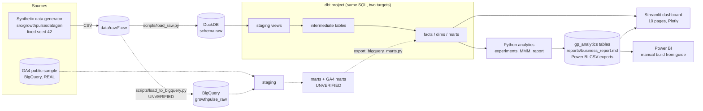

# Architecture

Solid arrows = verified locally in this build. Dashed = BigQuery mode, implemented but **not executed against a live project**.

## Layers and grain
| Layer | Schema (DuckDB / BigQuery suffix) | Contents | Materialisation |
|---|---|---|---|
| raw | `raw` / `growthpulse_raw` | 14 synthetic tables | loaded tables |
| staging | `gp_staging` / `_staging` | typed, renamed 1:1 copies | views |
| intermediate | `gp_intermediate` / `_intermediate` | sessions, visitors, customer acquisition, touchpoints, attribution credit | tables |
| marts | `gp_marts` / `_marts` | facts, `dim_customers`, 6 business marts | tables |
| ga4 | `_ga4` (BigQuery only) | GA4 staging (incremental), sessions, orders, funnel, channels | incremental + tables |
| analytics | `gp_analytics` (DuckDB only) | experiment, MMM and recommendation tables written by Python | tables |

## Lineage (synthetic path)
`stg_sessions, stg_events, stg_customers, stg_subscriptions` -> `int_sessions` -> `int_visitors` -> `int_customer_acquisition` -> `int_touchpoints` -> `int_attribution_credit` -> `mart_marketing_performance` -> `mart_channel_unit_economics`.
`stg_payments + stg_refunds` -> `fct_payments` -> `fct_customer_revenue` -> `dim_customers`, `mart_customer_retention`, `mart_mmm_weekly`.
`stg_ad_spend + stg_campaigns + stg_channels + int_sessions` -> `fct_marketing_spend`.

## Key design decisions
1. **One SQL codebase, two engines.** dbt-duckdb gives a free local target; `dbt-bigquery` is the cloud target. Engine differences (week start, date arithmetic, types) are isolated in `macros/portable_sql.sql`.
2. **Metrics logic is tested twice.** SQL ratios in marts and Python functions in `metrics.py` share definitions; attribution SQL is checked against an independent pandas implementation.
3. **Dashboard computes from marts.** Filters re-aggregate mart rows through the same tested functions.
4. **Censoring-aware metrics.** ROAS/LTV windows use only fully observed cohorts.
5. **Synthetic ground truth lives outside the warehouse** so analyses cannot peek at it.
